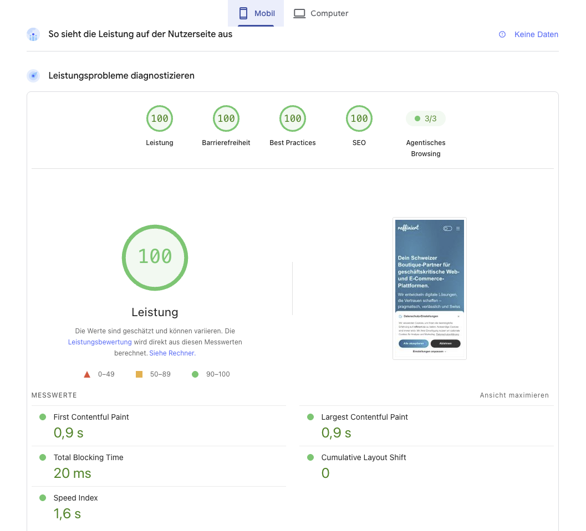

# payload-live-preview-inspector

Click-to-edit for [Payload CMS](https://payloadcms.com)'s own [Live Preview](https://payloadcms.com/docs/live-preview/overview) - click a component in the preview and land on its field - and an editing workspace around Payload's own form.

- **Click to edit.** Hover a component in the preview to highlight it, click it, and the edit form goes straight to the matching field: tabs switched, accordions and rows opened, the field flashed and focused, the caret on the word you clicked. It works the other way round too: focusing a field in the form scrolls the preview to it.
- **An editor around the form.** A divider between form and preview, an outline of the document, a path bar, focus mode, a block toolbar in the preview (move, duplicate, add, remove, with undo), screen widths for the preview, and a layout that works on a phone.

Everything is done through Payload's form API and saved the way any edit is: nothing here changes how your content is stored.

This plugin does **not** set up Live Preview itself. It works on top of an already-working `admin.livePreview` configuration.


## How it works

`LivePreviewInspectorClient` (in your frontend) highlights the tagged element under the pointer and, on click, posts its field path to the admin panel. `LivePreviewInspectorListener` (auto-registered by the plugin) resolves that path against the live form state and reveals the field. It reads the route there off the collection's field config rather than finding it by trial: which tabs to switch to (nested and named ones too), which collapsible fields to open, and which Array/Blocks rows to expand, all rows in one step through the form state. It then scrolls, flashes and focuses the field. A newer click cancels a reveal still in flight. Targeting is point-based and picks the smallest tagged element, so text stays clickable even beneath a full-card overlay link.

Clicking text also carries the **position within it**, so the cursor lands on the word you clicked rather than at the start of the field. Preview and admin never share the same markup, so the position travels as the surrounding text with an offset into it (invisible stega characters stripped, whitespace collapsed), which the listener maps back onto whichever text node holds it in the editor. Rich text (Lexical) gets a real caret; `text`/`textarea` inputs get their selection set. When the text can't be found (a stale preview, an edited value), focusing falls back to the start of the field.

The reverse direction needs no separate tagging: the listener notices focus anywhere in the admin form, reads the field's own path off its DOM and posts it to the preview, which scrolls to and flashes the tagged element for that path. For a rich-text field the message also carries **where the caret is**, so the preview scrolls to the paragraph being edited rather than to the first one. Only *your* focus counts: the focus a reveal performs is not sent back, so each direction moves only the other side.

Elements get their path attribute through three layers: explicit tagging always wins, and each layer only fills what the previous one didn't cover (details in [Tagging](#tagging-three-layers)):

1. **`pathOf()` (explicit):** you tag an element yourself; exact, works for anything.
2. **Stega (automatic, opt-in):** `inspectable(data, { stega: true })` encodes each string field's path into its value as invisible characters; the client decodes them from the rendered DOM.
3. **Value matching (automatic, zero-config):** tags any element whose whole text equals exactly one field's current value.

From auto-tagged leaves, the client also **infers block containers**, so clicking a block's padding selects the whole row.

## Installation

```sh
pnpm add @raffiniert-media-ag/payload-live-preview-inspector
```

Requires `react`/`react-dom` 19 and Payload 3.84.1 or newer; `payload` and `@payloadcms/ui` are optional peers only needed on the admin side. The package has four entry points, split so nothing heavy can leak into your frontend bundles:

| Subpath     | Contains                                                               | Import it from                                  |
| ----------- | ---------------------------------------------------------------------- | ------------------------------------------------ |
| `.`         | `payloadLivePreviewInspector()` plugin                                         | `payload.config.ts`                              |
| `/client`   | `LivePreviewInspectorClient` (a `'use client'` component)                      | only the file that mounts the component          |
| `/path`     | `inspectable`, `pathOf`, `stegaClean`, constants: pure, no components | everywhere else: pages, blocks, Server Components |
| `/listener` | admin-side listener (imports `@payloadcms/ui`)                         | nowhere: the plugin wires it up for you          |

Bundlers treat `'use client'` barrels as indivisible: importing helpers from `/client` inside any client component drags the whole preview half into every visitor's bundle. Import them from `/path` instead.

## Setup

### 1. Admin (Payload config)

List the collections/globals to edit visually (each must already have Live Preview enabled):

```ts
import { payloadLivePreviewInspector } from '@raffiniert-media-ag/payload-live-preview-inspector'

export default buildConfig({
  admin: {
    livePreview: {
      collections: ['posts'],
      url: ({ data }) => `https://your-frontend.example.com/preview/posts/${data.id}`,
    },
  },
  plugins: [
    payloadLivePreviewInspector({
      collections: { posts: true },
      globals: { siteSettings: true },
    }),
  ],
})
```

Optional overrides (defaults shown): `flashColor` (Payload's accent, `--theme-success-500`), `flashDurationMs: 1200`, `scrollOffset: 100`, `scrollBehavior: 'smooth'`, `accordionAnimationMs: 350`, `tabSwitchWaitMs: 1500` (max wait for freshly mounting fields after a tab switch, an expansion or a scroll; raise it if very heavy tabs get skipped), and `editor` (see [The editor](#the-editor)).

After adding the plugin, regenerate Payload's import map (`payload generate:importmap`): the plugin registers its admin component by its package path.

### 2. Frontend

Mount `LivePreviewInspectorClient` once, near the root of whatever page renders inside the Live Preview iframe:

```tsx
import { LivePreviewInspectorClient } from '@raffiniert-media-ag/payload-live-preview-inspector/client'

export default function PreviewPage() {
  return (
    <>
      <LivePreviewInspectorClient />
      {/* ...your page... */}
    </>
  )
}
```

If Payload's admin runs on another origin than the site (say `cms.example.com` previewing `www.example.com`), name it: `<LivePreviewInspectorClient targetOrigin="https://cms.example.com" />`. Without it, the preview only talks to its own origin, which is right whenever Payload and the site are one app; see [Security](#security).

Then tag elements. The recommended way is `inspectable()` + `pathOf()`: wrap your document data once, and every nested node knows its own field path. Array/blocks rows are addressed by their stable `id`, so the mapping survives reordering. Plain JavaScript, no hooks, so it works in Server Components too:

```tsx
import { inspectable, pathOf } from '@raffiniert-media-ag/payload-live-preview-inspector/path'

const page = inspectable(data)

<h1 {...pathOf(page, 'title')}>{page.title}</h1>

{page.layout?.map((block) => (
  <section key={block.id} {...pathOf(block)}>
    <h2 {...pathOf(block, 'heading')}>{block.heading}</h2>
  </section>
))}
```

`pathOf(node)` addresses the node itself (e.g. a whole block); `pathOf(node, 'fieldName')` a field on it. You don't have to tag everything by hand: the two automatic layers below fill most gaps. Tagging a block itself (`pathOf(block)`) is what gives the block toolbar a precise frame for it.

## The editor

Every part is on by default. Turn parts off, or change the screen widths, with the plugin's `editor` option:

```ts
payloadLivePreviewInspector({
  collections: { pages: true },
  editor: {
    blockToolbar: true,
    compactDescriptions: true,
    editUploadInLibrary: false, // Payload's pencil on a file: off unless asked for
    focusMode: true, // true or 'on': offered, starts on; 'off': offered, starts off; false: gone
    outline: true,
    pageMode: true, // the same three choices as focusMode
    pathBar: true,
    replaceUpload: true,
    split: true,
    stacked: true,
    viewports: [
      { name: 'mobile', width: 390 },
      { name: 'tablet', width: 768 },
      { name: 'desktop', width: 1440, label: { de: 'Desktop', en: 'Desktop' } },
    ], // or false
  },
})
```

- **Page mode (`pageMode`).** While the live preview is open, the page is where the editor works. Payload's header and the document's title bar fold into the bar with the save buttons, which carries the title, the way back to the list, the status (with Payload's way back to the published version) and the versions; Payload's size, zoom and breakpoint controls make way for the screen widths. On a narrow screen the preview fills it, and the form comes up from below for what was tapped - only that block, with the path bar and a close button on top; closed again, the page is all there is. Starts on, and the editor turns it off and on in the button at the bottom right, remembered per browser.
- **The button at the bottom right.** The editor's switches - page mode, focus mode, the outline - named, each with a line on what it does. Payload's colours, under Payload's drawers and toasts. On a phone, before anything was tapped, it also opens the form, and says once that a tap edits.
- **Divider (`split`).** Drag the line between form and preview, or use the arrow keys; double-click (or Enter) restores Payload's split. While dragging only a line moves, with both widths on it; the panes are resized once, on release. Remembered per browser; neither side gets narrower than 320 px.
- **Outline (`outline`).** Every Array and Blocks row of the document as a tree beside the form, named the way the form names it (`Section 3`) and recognisable by what it holds (its block name, or its first words), with rows that fail validation marked. Built from the field config and the form state, so a row closed three levels down is in it. A click goes there in the form and selects it in the preview; hovering marks it in the preview. Filter, and the keyboard of an ARIA tree.
- **Path bar (`pathBar`).** Above the form: where the selected block sits (`All fields › Section 3 › Row 1 › Column 2 › Text 1`), every crumb a way back up, with the outline and focus switches beside it.
- **Focus mode (`focusMode`).** The form shows only the selected block, right under the bar, without the frames and indents of the rows around it. Nothing is hidden in the form state or saved; "All fields" shows everything again. Starts on; the switch is in the path bar and in the button at the bottom right.
- **Block toolbar (`blockToolbar`).** In the preview, the selected block is framed with its name and buttons to step out to the block around it, move it up or down, duplicate it, add one below (Payload's own block drawer) and remove it. What a row allows comes from the admin: `minRows`, `maxRows`, `isSortable`, read-only fields and the user's field permissions. Moves, duplicates and removals show a toast with **Undo**.
- **Screen widths (`viewports`).** Phone, tablet and desktop buttons in Payload's bar above the preview lay the page out at that width, zoomed to fit the panel and refitted as the divider moves, through Payload's own preview size and zoom. Clicking the chosen one again returns to the panel's own width.
- **Narrow screens (`stacked`).** At and below Payload's 1024 px break the preview sits above the form, with a divider between them (touch included), instead of the form disappearing. The outline opens as a sheet.
- **The bar above the preview** carries the screen widths and the hint about what a click does - as a sentence until the editor has clicked their way to a field once, then as an icon. Where the preview is dragged narrow, it gives up, in this order, the hint's sentence, Payload's width and height fields, and Payload's breakpoint menu, so nothing overlaps.
- **Replacing a file (`replaceUpload`, `editUploadInLibrary`).** An upload field with a file gets **Replace**: Payload's library opens, and the file chosen there takes the old one's place - one step, where Payload's own way is to remove the file and then choose. Payload's pencil beside it is off: it opens the file's own document, and a change there - alt text, focal point - changes the file wherever it is used, which on a page reads as "edit this image here". `editUploadInLibrary: true` brings it back. Single-file fields; a gallery keeps Payload's list.
- **Descriptions (`compactDescriptions`).** A field's description is one line until the editor is in that field, then whole: a form whose every field explains itself in two to four lines reads as a wall.

Everything the editor says is in German or English, by the admin's language.

## Tagging: three layers

Explicit `pathOf()` attributes are never overwritten by the automatic layers; auto-tagged elements carry `data-payload-live-preview-auto="stega" | "match" | "container"` so you can tell them apart in devtools.

### 1. `pathOf()`: explicit, most precise

Works for anything (images, numbers, whole blocks, elements without text) and relies on no heuristic. Use it wherever the automatic layers don't reach.

### 2. Stega: automatic tagging for text content

Pass `stega: true` to `inspectable()` and every prose string read from the proxy carries its field path as invisible characters. Wherever it ends up in the DOM, however many component or server/client boundaries it crossed, the scanner tags the containing element. `alt`, `title`, `aria-label`, and `placeholder` attributes are scanned too.

**The two-word safety rule:** only strings with **at least two whitespace-separated words** are encoded. Single tokens (`'default'`, `'topRight'`) are what code uses as object keys and comparison targets; encoding one would silently break lookups like `styles[block.variant]`. Select/radio/enum values practically never contain whitespace, so they're safe by construction. The flip side: single-word display text isn't stega-tagged (value matching or `pathOf()` covers it). Also skipped: `id`/`blockType`/`blockName`/`slug`, URL-/date-/number-/uuid-shaped values, and strings inside arrays. Exception: `alt`, `ariaLabel`, `placeholder` are always encoded; they only land in attributes value matching can't reach, and code never compares them.

Fine-tuning and raw values when you need them:

```ts
const page = inspectable(data, {
  stega: {
    encodeKeys: ['buttonLabel'],  // always encode - fields you KNOW are display text
    skipKeys: ['cssClasses'],     // never encode
    filter: ({ defaultEncode, key, path, value }) => defaultEncode, // final say per string
  },
})

import { stegaClean } from '@raffiniert-media-ag/payload-live-preview-inspector/path'
stegaClean(page.title) // raw string - use before ===, new Date(), APIs; also deep-cleans objects
```

Trade-off: encoded strings contain extra characters. `===` against literals fails and `slice()` can destroy a tag (it's then simply lost, never wrong). All of it exists only in preview mode (see [Production](#production--performance)).

### 3. Value matching: zero-config

On by default. The client asks the admin panel for the document's current text values (the admin sends them again once the editor pauses typing) and tags any element whose entire text equals exactly one field's value; when an element's text changes, its tag is judged again. Rich-text fields contribute their individual text runs, mapped back to their editor. Deliberately conservative: values shared by several fields (e.g. a hero title duplicated into the SEO title) are never matched, values under 3 characters are ignored, and only whole-element matches count. In development, the preview console logs each skipped ambiguous value with the colliding field paths. Set `valueMatching={false}` to turn it off.

### Container inference

Elements whose paths share an Array/Blocks row prefix vote for their closest common ancestor as that row's container. Skipped when the row is already tagged, and never applied to ancestors containing another row's elements. `pathOf(block)` remains more reliable for blocks that render little text.

## What a click in the preview does

A click that resolves to a field **only** reveals that field. The page's own handler never runs, so a card does not open its dialog, a popup trigger does not open its popup and a carousel arrow does not advance: click-to-field means one thing happens, not two. Pass `disableInteractions={false}` to get the old behaviour, where a click did both.

**Hold ⌥/Alt to operate the page instead.** The click is then an ordinary click and no field is revealed, which is how an editor opens a dialog, steps a carousel or expands an accordion to look at what is inside it, and the only way to reach that content in order to click into *it*. `interactionModifier` picks the key (`'alt' | 'ctrl' | 'meta' | 'shift' | 'none'`); `'none'` removes the escape hatch. The hint in the bar above the preview names whichever key is configured, because the preview reports its setting to the admin, so an editor can find it without reading this file.

A click is answered in the frame it happens in: the element is framed and tinted, a ripple spreads from the pointer, and a chip names the field by the label the admin shows for it (`→ Überschrift`). Where the form has to open rows or switch tabs to get there, it does so in one movement; with `scrollBehavior: 'instant'` the form fades out, opens everything unseen and fades back in at the field. If the admin has no field to go to (a row deleted after the preview rendered), the mark turns red and says so. All of it takes the admin's accent colour (Payload's `--theme-success-500`, light or dark theme).

A click that resolves to **no** field is never taken. Anything outside the edited document (a header, a cookie banner) keeps working exactly as it does for a visitor.

The interception listens on `window` rather than on `document`, which matters whenever the host page has a capture-phase click handler of its own: two capture listeners on the same node run in registration order, and the capture phase descends Window → Document, so listening a level up is first regardless of mount order.

Links are the exception, and they split in two. `disableLinks` (default `true`) stops every `<a href>` from navigating, including client-side router links (Next.js `<Link>` etc.), which are intercepted in the capture phase before their own handler runs.

- **A link that leaves the page** stays blocked even under the modifier. Every browser gives alt-, meta- and shift-click on a link its own meaning (download, new tab, new window), so passing it on would not mean "navigate" anyway, and leaving the preview is never what the click was for.
- **A link into the same page** (a `#fragment`, which is what an in-page control like a popup trigger is built from) is handed to the page under the modifier, with the browser's own behaviour prevented. So ⌥-clicking a popup trigger opens the popup and does not jump, download or navigate.

Middle-clicks arrive as `auxclick` and are not intercepted. Pass `disableLinks={false}` to restore navigation.

## Security

The admin and the preview talk through `postMessage`, and the preview can change the document (the block toolbar). Both directions are locked down:

- **The preview talks only to the admin's origin.** `LivePreviewInspectorClient` listens to and posts to `targetOrigin`, which defaults to the page's own origin. Where the browser names the page framing the preview (`location.ancestorOrigins`) and it is another origin, the preview half does not start at all: no click capture, no tagging, no messages. Before 2.0 the origin was taken from whatever framed the page, so a page framing a public site could receive the paths and text of what was clicked there. `targetOrigin: '*'` restores that trust; avoid it.
- **The admin listens only to its preview.** Messages are accepted only from the live preview iframe's own window and origin; nested frames inside the preview (a YouTube or Maps embed) are ignored.
- **Changes need a person.** Block actions that change the document (move, duplicate, add, remove) are taken from the preview only right after a real click or key press there: a script the site loads could otherwise post as the preview. They run one at a time, each checked against the form as it is at that moment (`minRows`, `maxRows`, `isSortable`, a read-only form or field, and the user's field permissions); Payload enforces access again on save.
- **Secrets stay in the admin.** Value matching sends the document's text values to the preview's origin only, and never an auth collection's `password`, `confirm-password` or `apiKey`.
- **No HTML from content.** Labels, block names and summaries are rendered as text, never as markup.

Also send a `Content-Security-Policy: frame-ancestors` header on your preview routes naming your admin's origin, so no other site can frame them in the first place.

## When Payload changes underneath

The editor reads Payload's rendered admin (class names, element ids, attributes), which is Payload's implementation, not its API. Everything it reads lives in one file, `src/utilities/payloadAdmin.ts`, and the test suite checks every name against the installed `@payloadcms/ui`, so an upgrade that renames one fails there by name. At runtime:

- The admin editor and the preview half each sit behind an error boundary. If either throws, it disappears and logs why, and Payload's edit view (or the site's page) carries on exactly as without the plugin.
- When the edit view lacks a part the editor hangs on, the console names it once (`[payload-live-preview-inspector] Not found in Payload's admin: …`) instead of pieces of the editor quietly missing.

CI runs the suite against the Payload version the dev app pins and the oldest one the peer range admits.

## Sticky headers

Both directions scroll something into view, and "in view" is not the same claim as "at the right height". After the preview scrolls to an element, the plugin asks the page what is actually painted just above and just inside that element's top edge; if it is a `sticky` or `fixed` element, the element is scrolled clear of it. The block toolbar keeps clear of it the same way.

It is asked of the page rather than configured, because a number cannot be right: the height of a site's header is not something this plugin can know, at a width it cannot predict. The correction loops, because a header that hides on scroll *reappears* when the page scrolls up and takes back most of the first correction.

## Server/client component boundaries

The proxy's path metadata doesn't survive serialization: passing a wrapped node from a Server Component into a Client Component makes `pathOf()` come up empty on the other side. In order of preference:

1. **Stega:** the path travels inside the string value itself, surviving any boundary.
2. **`serializable: true`:** embeds each node's path as a `__payloadLivePreviewPath` property that survives JSON (visible in `Object.keys()`; array nodes can't carry it, their object children do).
3. **Pass `pathOf()` results as props:** they're plain serializable objects.

## Production / performance

Nothing here reaches real visitors: outside the admin's live preview the client attaches no listeners and scans nothing (its only cost is its bundle, about 11 kB gzipped), the proxy overhead is negligible, and path attributes/stega characters exist only while enabled. A production site running this plugin scores **100/100 mobile Performance** in Lighthouse:



The cleanest setup is a dedicated preview route (like this repo's `dev/app/(frontend)/preview/...`), so the public route never imports any of this; or mount the client only in draft mode. If you share components between public and preview rendering, `enabled` is the single kill switch for all output layers:

```tsx
import { draftMode } from 'next/headers'

const { isEnabled } = await draftMode()
const page = inspectable(data, { enabled: isEnabled, stega: true })
// enabled: false → no path attributes, no stega characters, no markers.
```

In the admin, the editor stays out of the way of typing: only a small watcher re-renders per keystroke, the outline catches up 200 ms after a change and the preview's values 600 ms after typing pauses, and the preview's block toolbar rests while nothing moves.

## Upgrading from 1.x

1. `pnpm add @raffiniert-media-ag/payload-live-preview-inspector@^2`. Same package, same imports, same import map.
2. If your admin runs on another origin than the site, pass `targetOrigin` to the client (see [Security](#security)). Without it, the preview now only talks to its own origin - the one change in 2.0 that can break a setup.
3. Page mode and focus mode now start switched on, each a switch an editor can turn off; `editor: { pageMode: 'off', focusMode: 'off' }` makes the 1.x layout the default again. See the [CHANGELOG](./CHANGELOG.md).

## API reference

From `.` (Payload config):

- `payloadLivePreviewInspector({ collections?, globals?, disabled?, editor?, flashColor?, flashDurationMs?, scrollOffset?, scrollBehavior?, accordionAnimationMs?, tabSwitchWaitMs? })`: see [Setup](#1-admin-payload-config) and [The editor](#the-editor).
- Types: `PayloadLivePreviewInspectorConfig`, `EditorFeatures`, `Viewport`.

From `/path` (pure helpers, safe anywhere; also re-exported from `/client`):

- `inspectable(data, options?)`: path-tracking proxy. Options: `enabled`, `stega: true | { encodeKeys?, skipKeys?, filter? }`, `serializable`.
- `pathOf(node, subPath?)`: the path attribute for a wrapped node.
- `isInspectable(node)`: whether `node` came out of `inspectable()`, silently. `pathOf()` warns in development when handed unwrapped data, which is right for a component that expected a wrapped node and wrong for a shared renderer legitimately called with both. Ask first, then tag: `{...(isInspectable(block) ? pathOf(block) : undefined)}`. A tree wrapped with `enabled: false` counts as inspectable.
- `stegaClean(value)`: strips stega characters from a string or a whole object tree.
- `LIVE_PREVIEW_PATH_ATTRIBUTE`, `LIVE_PREVIEW_AUTO_ATTRIBUTE`, `SERIALIZED_PATH_KEY`, `LIVE_PREVIEW_HOVER_CLASS_NAME`: the raw attribute/class names, e.g. to tag or restyle manually.

From `/client` (import only where you mount it):

- `LivePreviewInspectorClient({ blockToolbar?, disableInteractions?, disableLinks?, hoverColor?, interactionModifier?, stega?, targetOrigin?, valueMatching? })`, all optional. `blockToolbar` (default `true`) shows the block toolbar in the preview. `disableInteractions` (default `true`) keeps a revealing click from also operating the page, and `interactionModifier` (default `'alt'`) is the key that turns it back into an ordinary click; see [What a click in the preview does](#what-a-click-in-the-preview-does). `targetOrigin` (default: the page's own origin) is the admin's origin, the only one the preview talks to; see [Security](#security).

From `/listener`: `LivePreviewInspectorListener`, admin-side; the plugin registers it for you.

## Known limitations

- Fields that only render inside a relationship's edit drawer aren't reachable: the click silently no-ops. Same for a row deleted after the preview was rendered.
- `scrollBehavior: 'instant'` trades the scroll animation for responsiveness; the flash and the caret land once the form has stopped moving. A `prefers-reduced-motion` preference is honoured regardless of this setting.
- The route to a field comes from the field config. Where the config can't tell it (a field rendered by a custom component, a tab with nothing identifiable in it), the reveal falls back to clicking through the form's tabs, restoring the originals when nothing is found. Fields that mount slower than `tabSwitchWaitMs` can make the reveal settle on the nearest parent; raise the option for very heavy forms.
- Multi-locale setups or drawer-duplicated fields can get suffixed DOM ids; the `field-<path>` lookup may occasionally miss there.
- Stega only reaches values rendered as text (or `alt`/`title`/`aria-label`/`placeholder`) with two or more words; string operations that reshape a value (`slice()`, regexes) destroy the tag: the element is then untagged, never mistagged. Copied preview text carries the invisible characters (preview-only).
- Value matching needs exact whole-element equality with exactly one field's value: formatted dates, truncated teasers, and duplicated values don't match, by design. Text that was on the page all along and only now equals a value someone typed is matched once typing stops.
- Container inference backs off on interleaved markup and blocks that render no taggable leaf; use `pathOf(block)` there.
- Caret placement anchors on the clicked text (up to 120 characters either side); where that exact text occurs more than once in the same field, the first occurrence wins.
- Focusing a field scrolls the preview only when *something* under its path is tagged.
- The preview follows the caret on focus and on clicks inside the editor, not while typing or on arrow keys, so it never scrolls out from under you mid-sentence.
- The block toolbar's actions need a browser that reports user activation (`navigator.userActivation`); where it is missing, they are accepted as before.

## Local development

The `dev/` folder is a full Payload app (SQLite, nothing external) for developing the plugin:

```sh
pnpm install
pnpm dev        # http://localhost:3000/admin - dev@payloadcms.com / test
pnpm test:int   # vitest unit tests
pnpm test:e2e   # playwright - the whole flow in a browser
```

`/admin/collections/pages` holds the complex page fixture (`dev/collections/Pages.ts`): forty collapsed sections, tabs inside block rows, arrays in collapsed rows and a collapsible in the last tab. The e2e suite holds every reveal on it to one click, a time budget and one calm motion. Every reveal leaves a `performance.measure` entry (`payload-live-preview-inspector:reveal`, with per-phase timings in `detail`) and logs its breakdown to the console in development. `BASELINE=1 pnpm test:e2e -g "complex page"` records click-to-flash times without asserting them, for comparing another build; `CPU_THROTTLE=4` runs the motion tests on a slower machine.

## About

Built by [Raffiniert](https://raffiniert.biz). Read more in our blog post [Visuelles Editieren in Payload CMS: unser Live Preview Inspector Plugin](https://raffiniert.biz/stories/visuelles-editieren-in-payload-cms-unser-live-preview-inspector-plugin). Questions, custom Payload work, or want to work with us? [Get in touch](https://raffiniert.biz).
